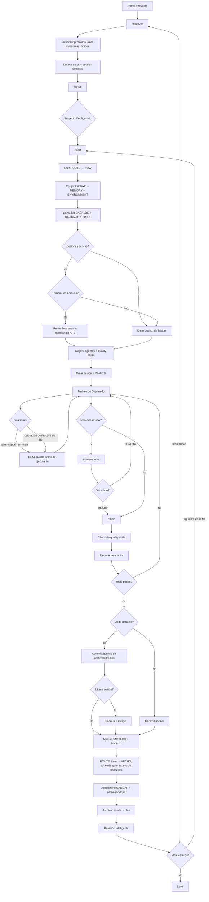

# workflowIA

[](https://claude.ai/claude-code)
[](https://opensource.org/licenses/MIT)

**[Read in English](README.md)**

Template de proyecto battle-tested para desarrollo asistido por IA con Claude Code. Provee seguimiento de sesiones, flujos de trabajo estructurados, 9 agentes especializados, 26 reglas enforced, guardrails determinísticos que corren como hooks, soporte de sesiones paralelas y trazabilidad completa del desarrollo. Nacido de 200+ sesiones reales de desarrollo.

## Características

- **Descubrimiento Conversacional** (`/discover`) - Encuadra un proyecto nuevo y deriva su stack de las respuestas; también sirve para pensar features nuevos sobre un proyecto andando
- **Wizard de Configuración** (`/setup`) - Configura tu proyecto con preguntas guiadas
- **Guardrails Determinísticos** - Hooks que deniegan operaciones peligrosas de git y de base de datos *antes* de que se ejecuten, en vez de confiar en que la regla se recuerde
- **Anti Context-Rot** - Foto del estado antes de compactar, contexto crítico re-inyectado después
- **ROUTE — la fila de trabajo** - Una página que contesta "¿qué sigue?" en 30 segundos
- **Seguimiento de Sesiones** - Documenta cada sesión de desarrollo automáticamente
- **Flujo Estructurado** - Iniciá y finalizá features con `/start` y `/finish`
- **9 Agentes Especializados** - Context provider, feature architect, test engineer, y más
- **Code Review Multi-Categoría** - Auditorías estructuradas con veredictos READY/PENDING/CONDITIONAL
- **Auditoría del Sistema** (`/audit`) - Escaneo de salud con 8 módulos e integración con BACKLOG
- **Tracking BACKLOG + ROADMAP** - Consistencia bidireccional entre sesiones e ítems del backlog
- **Registro de FIXES** - Tracking centralizado de bugs con flujos rápido/complejo/batch
- **Rastro de Evidencia** - `verifications/` guarda qué se probó realmente, aparte de qué se decidió
- **Sistema MEMORY** - Lecciones aprendidas persistentes entre sesiones (integración opcional con Engram)
- **Planes de Implementación** - Flujo estructurado de planes con archivado
- **26 Reglas Enforced** - Prácticas de desarrollo probadas en producción
- **Sesiones Paralelas** - Soporte de rama compartida para 2+ instancias de Claude trabajando simultáneamente
- **Integración Context7** - Documentación actualizada de librerías durante el desarrollo
- **Rotación Inteligente** - Limpieza que mantiene las sesiones recientes y comprime las viejas
- **Skills de Calidad** - Chequeos de calidad externos configurables para frontend y más
- **Todo Configurable** - Package manager, comandos, convenciones git, idiomas, umbrales
- **Integración MCP** - Buscá, explorá e instalá MCP servers
- **Soporte Bilingüe** - Preferencias de idioma para código y chat

## Inicio Rápido

### 1. Clonar o Usar Template

```bash
# Clonar el repositorio
git clone https://github.com/brujoh88/workflowIA.git mi-proyecto
cd mi-proyecto
```

### 2. Inicializar Git (si es proyecto nuevo)

```bash
git init
```

### 3. Encuadrar el Proyecto

Abrí Claude Code y ejecutá:

```
/discover
```

Una conversación sobre el **negocio**, no sobre la tecnología: qué se rompe hoy, quién lo toca,
qué no puede pasar nunca, qué bordes cambian el diseño, y cuán chica es la primera versión útil.
El stack sale **derivado de esas respuestas**, con su razonamiento y las alternativas descartadas.
Deja escritos el contexto de negocio, un ADR, el ROADMAP, el BACKLOG y el primer ítem de la
ROUTE — sin escribir código ni instalar nada.

### 4. Ejecutar el Wizard de Configuración

```
/setup
```

Esto va a:
- Recopilar metadata del proyecto, stack y preferencias
- Configurar comandos, convenciones git y umbrales de calidad
- Instalar los git hooks (pre-commit, commit-msg, post-commit) y registrar los hooks de Claude Code
- Apagar `git.allowCommitsOnMain` para que la rama protegida quede realmente protegida
- Crear MEMORY.md para lecciones persistentes
- Crear la estructura de carpetas
- Sugerir MCP servers relevantes (incluyendo Context7)

### 5. Empezar a Desarrollar

```
/start                # Toma el ítem que está en ROUTE.md → NOW
... tu trabajo ...
/review-code          # Auditoría multi-categoría con integración de skills de calidad
/finish               # Tests + commit + actualiza ROUTE/BACKLOG + archiva + rotación
```

¿Se te ocurre un feature nuevo con el proyecto andando? Corré `/discover` de nuevo — el modo B lo
dimensiona, chequea si duplica una regla existente y lo ubica en la fila.

---

## Diagrama de Flujo



---

## Estructura del Proyecto

```
.
├── .claude/
│   ├── project.config.json       # Toda la configuración del proyecto
│   ├── settings.json             # Config de plugins + registro de hooks de Claude Code
│   ├── settings.local.json       # Permisos (no se commitea)
│   ├── MANUAL.md                 # Guía de usuario del framework
│   ├── MEMORY.md                 # Lecciones aprendidas persistentes
│   ├── plan/                     # Planes de implementación (gitignored)
│   │   └── completados/          # Planes archivados
│   ├── skills/
│   │   ├── discover/             # Encuadre de producto + descubrimiento de features [NUEVO]
│   │   ├── setup/                # Wizard de configuración
│   │   ├── start/                # Iniciar feature (lee ROUTE → NOW)
│   │   ├── finish/               # Finalizar feature (actualiza ROUTE, rotación)
│   │   ├── review-code/          # Auditoría (frontend/E2E + quality skills)
│   │   ├── audit/                # Auditoría del sistema (8 módulos)
│   │   ├── architecture-ref/     # Patrones de arquitectura (auto-cargado)
│   │   ├── development-protocol-ref/ # Protocolo de desarrollo
│   │   ├── ui-design-system-ref/ # Referencia de diseño UI
│   │   ├── explore-code/         # Exploración de código
│   │   ├── fix-issue/            # Flujo de corrección de bugs
│   │   ├── deploy/               # Flujo de deployment
│   │   ├── metrics/              # Dashboard de métricas del proyecto
│   │   └── mcp/                  # Gestión de MCP servers
│   ├── agents/                   # 9 agentes especializados
│   │   ├── session-tracker.md    # Ciclo de vida + commits anti-loop
│   │   ├── context-provider.md   # Snapshot + caminos sugeridos
│   │   ├── feature-architect.md  # Estructura + anatomy docs
│   │   ├── code-reviewer.md      # Auditoría standalone
│   │   ├── code-explorer.md      # Navegación del codebase
│   │   ├── test-engineer.md      # Tests + cobertura ANTES/DESPUÉS
│   │   ├── db-analyst.md         # Diseño de schemas + migraciones
│   │   ├── api-documenter.md     # Auditoría de documentación API
│   │   └── frontend-integrator.md # Componentes + a11y + dark mode
│   └── rules/                    # Reglas por contexto
│       ├── api.md
│       ├── database.md
│       └── frontend.md
├── context/
│   ├── ROUTE.md                  # LA fila de trabajo: NOW / QUEUE / DONE [NUEVO]
│   ├── README.md                 # Índice de sesiones + reglas de rotación
│   ├── BACKLOG.md                # Inventario completo de pendientes (<300 líneas)
│   ├── ROADMAP.md                # Seguimiento de progreso por módulo
│   ├── FIXES.md                  # Registro de bugs/fixes
│   ├── ENVIRONMENT.md            # Accesos, BD, trampas de la API [NUEVO]
│   ├── .pending-commits.log      # Commits auto-registrados (local, gitignored)
│   ├── tmp/                      # Sesiones activas + foto pre-compactación
│   ├── verifications/            # Evidencia de rondas de prueba manual [NUEVO]
│   ├── archive/
│   │   ├── COMPLETED.md          # Historial de ítems completados
│   │   └── YYYY-QN/
│   │       ├── sessions/         # Sesiones archivadas (trimestre por fecha de SESIÓN)
│   │       └── SUMMARY.md        # Resumen trimestral
│   ├── auditorias/               # Reportes de auditoría
│   └── consolidated/             # Documentación por feature completado
├── scripts/
│   ├── context-lock.sh           # Lock distribuido para sesiones paralelas
│   └── hooks/
│       ├── pre-commit            # Rama protegida, tamaño de archivo (R4), errores TS (R16)
│       ├── commit-msg            # Sin atribución a IA + formato de commit (R3) [NUEVO]
│       ├── post-commit           # Auto-registra commits (con anti-loop)
│       ├── post-merge            # Importa memorias de Engram tras un pull [NUEVO]
│       ├── claude-guard-main.sh  # Deniega commit/push en la rama protegida [NUEVO]
│       ├── claude-guard-db.sh    # Deniega operaciones destructivas de BD [NUEVO]
│       ├── claude-precompact.sh  # Foto del estado antes de compactar [NUEVO]
│       └── claude-session-context.sh # Re-inyecta contexto tras compactar [NUEVO]
├── CLAUDE.md                     # Instrucciones del proyecto (26 reglas + routing)
├── CLAUDE-CHANGELOG.md           # Historia del framework (fuera del contexto) [NUEVO]
└── CLAUDE.local.md               # Config local (no se commitea)
```

## Tres archivos, tres preguntas

| Pregunta | Archivo |
|----------|---------|
| **¿Qué hago ahora?** | `context/ROUTE.md` → NOW. Un ítem, una página. |
| **¿Qué falta en total?** | `context/BACKLOG.md` — el inventario completo, sin orden. |
| **¿Hacia dónde va el producto?** | `context/ROADMAP.md` — módulos, progreso, dependencias. |

Tenerlos separados es el punto: la ROUTE se mantiene lo bastante corta como para leerla de verdad
al empezar cada sesión, que es lo que la hace útil.

## Guardrails

Algunas reglas dependían de acordarse de ellas. Estas corren solas, antes que el comando.

| Hook | Tipo | Qué hace cumplir |
|------|------|------------------|
| `claude-guard-main.sh` | PreToolUse | Deniega `git commit`/`git push` en la rama protegida **antes** de ejecutarse |
| `claude-guard-db.sh` | PreToolUse | Deniega siempre las operaciones destructivas de BD; deniega migraciones fuera de Docker si está configurado |
| `commit-msg` | git | Bloquea atribución a IA + exige formato conventional |
| `pre-commit` | git | Rama protegida, tamaño de archivo por tipo (solo código fuente), errores de TypeScript |
| `claude-precompact.sh` | PreCompact | Guarda una foto del estado antes de que se resuma la conversación |
| `claude-session-context.sh` | SessionStart | Re-inyecta rama, sesión, ítem de la ROUTE y reglas clave tras compactar |

Un hook PreToolUse que sale con código 2 deniega la llamada y devuelve el motivo como feedback.
No son advertencias: el comando no se ejecuta.

> **Nota**: este repositorio viene con `git.allowCommitsOnMain: true`, porque su propia rama main
> *es* su rama de trabajo. `/setup` lo apaga en los proyectos derivados. Si clonás sin correr
> `/setup`, el guard de rama queda dormido.

## Agentes

9 agentes especializados, cada uno con un rol específico:

| Agente | Rol | Invocado Por |
|--------|-----|--------------|
| **session-tracker** | Ciclo de vida, commits anti-loop, rotación | `/start`, `/finish` |
| **context-provider** | Snapshot, caminos sugeridos, MEMORY | `/start` (auto), directo |
| **feature-architect** | Estructura, anatomy docs, límites de tamaño | `/start` (features nuevos) |
| **code-reviewer** | Auditoría standalone multi-categoría | `/review-code` |
| **code-explorer** | Navegación y comprensión del codebase | `/explore-code` |
| **test-engineer** | Tests con protocolo cobertura ANTES/DESPUÉS | `/finish` (auto), directo |
| **db-analyst** | Diseño de schemas, migraciones, queries, índices | Delegación directa |
| **api-documenter** | Auditoría de completitud de documentación API | Delegación directa |
| **frontend-integrator** | Componentes + WCAG AA + dark mode | Delegación directa |

## Comandos Disponibles

| Comando | Descripción |
|---------|-------------|
| `/discover` | Encuadrar un proyecto nuevo y derivar su stack, o pensar un feature nuevo |
| `/setup` | Wizard de configuración (config, hooks, MEMORY, calidad) |
| `/start [feature]` | Lee ROUTE → NOW + branch + sesión + Context7 + quality skills |
| `/finish` | Check de calidad + tests + actualiza ROUTE/BACKLOG + archiva + rotación |
| `/review-code` | Auditoría multi-categoría + frontend/E2E + integración quality skills |
| `/audit [módulo]` | Auditoría del sistema: Types, Security, Validation, Size, Coverage, Docs, Arch, Quality |
| `/explore-code` | Navegar y entender el codebase |
| `/fix-issue` | Flujo guiado de debugging (3 hipótesis) |
| `/deploy` | Build, verificar y deploy |
| `/metrics` | Dashboard de métricas y salud del proyecto (solo lectura) |
| `/mcp` | Buscar, instalar, configurar MCP servers |

## Configuración

Toda la configuración se guarda en `.claude/project.config.json`:

```json
{
  "project": { "name": "mi-proyecto", "description": "...", "stack": "..." },
  "language": { "code": "en", "chat": "es" },
  "commands": {
    "packageManager": "npm", "test": "npm test", "lint": "npm run lint",
    "dev": "npm run dev", "build": "npm run build", "syncTypes": ""
  },
  "git": {
    "branchPrefixes": { "feature": "feature/", "fix": "fix/", "hotfix": "hotfix/" },
    "mainBranch": "main", "devBranch": "", "coAuthoredBy": false,
    "allowCommitsOnMain": false
  },
  "conventions": { "files": "kebab-case", "commits": "conventional" },
  "workflow": {
    "maxFileLines": { "default": 400, "services": 500, "components": 300, "hooks": 150 },
    "maxFunctionLines": 50,
    "archiveRotationThreshold": 15, "blockRotationThreshold": 3,
    "backlogMaxLines": 300, "recentSessionsToKeep": 3, "coverageThreshold": 80,
    "staleSessionThreshold": 24, "testMaxWorkers": 2
  },
  "quality": { "externalSkills": [] },
  "docker": { "enabled": false, "dbContainer": "" },
  "memory": { "engram": { "enabled": false, "syncOnCommit": true, "importOnMerge": true } },
  "parallel": {
    "enabled": true, "lockTimeoutSeconds": 60,
    "lockFile": "context/.context.lock",
    "sharedBranch": { "enabled": true, "directory": "context/.parallel", "atomicCommits": true }
  },
  "initialized": true
}
```

## Reglas Enforced (26)

| # | Regla | Descripción |
|---|-------|-------------|
| R1 | Idioma | Responder/codear en el idioma configurado |
| R2 | Git Flow | main protegida, soporte de branch dev |
| R3 | Commits | Co-Authored-By configurable |
| R4 | Tamaño de archivos | Máximo de líneas por tipo — solo código fuente |
| R5 | Testing | Cobertura ANTES/DESPUÉS, umbral objetivo |
| R6 | Verificar primero | Glob+Grep antes de crear |
| R7 | Compactación BACKLOG | Mantener bajo el máximo de líneas |
| R8 | Delegación | Delegación obligatoria a agentes/skills |
| R9 | Planes | Flujo estructurado de planes |
| R10 | Flujo de Fixes | Patrones rápido/complejo/batch |
| R11 | No Acción Prematura | Leer, entender, preguntar |
| R12 | Protocolo de Debugging | 3 hipótesis antes de corregir |
| R13 | Disciplina de Sesión | Start crea, finish cierra |
| R14 | Cero Inferencia | Solo fuentes concretas |
| R15 | Quality Skills | Chequeos de calidad frontend |
| R16 | Diagnósticos LSP | Los errores de tipo son bloqueantes |
| R17 | Sync MANUAL | Mantener la documentación actualizada |
| R18 | Entorno Docker | Comandos de BD dentro del container |
| R19 | Límite de CPU | Workers de tests limitados |
| R20 | Protocolo de Migraciones | Generar diff, revisar, deploy |
| R21 | Sesiones Paralelas | Rama compartida, commits atómicos, context lock |
| R22 | Detección de Trimestre | Archivar por la fecha de la SESIÓN, nunca la de hoy |
| R23 | Guardrails Determinísticos | Los hooks hacen cumplir las reglas antes de que corra el comando |
| R24 | Modo `/fast` | Toggle del usuario; Claude lo sugiere, nunca lo activa |
| R25 | Una Regla, Un Lugar | "¿Se puede?" vive en una función pura que todos importan |
| R26 | Engram | Memoria persistente opcional para decisiones y causas raíz |

## Requisitos

- [Claude Code CLI](https://claude.ai/claude-code) instalado
- Git
- `jq` (recomendado — los hooks leen la config con él; sin él fallan hacia abierto)

## Contribuir

Las contribuciones son bienvenidas. No dudes en enviar un Pull Request.

## Licencia

Licencia MIT - ver [LICENSE](LICENSE) para más detalles.
