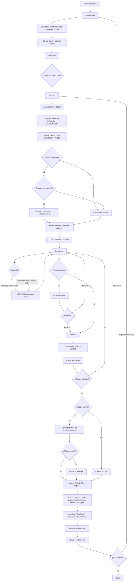

# workflowIA

[](https://claude.ai/claude-code)
[](https://opensource.org/licenses/MIT)

**[Read in English](README.md)**

Un flujo de desarrollo battle-tested para Claude Code, empaquetado como el plugin **`wf`**. Le da a
un proyecto seguimiento de sesiones, una fila de trabajo de una página, 9 agentes especializados,
26 reglas del framework, guardrails determinísticos que corren como hooks, soporte de sesiones
paralelas y trazabilidad completa del desarrollo. Nacido de 200+ sesiones reales de desarrollo.

El workflow vive **en el plugin**, no en tu proyecto: lo instalás una vez, y cada mejora le llega a
todos los proyectos que lo usan. Tu proyecto se queda solo con lo suyo: su config, su `context/` y
su `CLAUDE.md`.

## Características

- **Descubrimiento Conversacional** (`/wf:discover`) - Encuadra un proyecto nuevo y deriva su stack de las respuestas; también sirve para pensar features nuevos sobre un proyecto andando
- **Wizard de Configuración** (`/wf:setup`) - Configura tu proyecto con preguntas guiadas
- **Guardrails Determinísticos** - Hooks que deniegan operaciones peligrosas de git y de base de datos *antes* de que se ejecuten, en vez de confiar en que la regla se recuerde
- **Anti Context-Rot** - Foto del estado antes de compactar, contexto crítico re-inyectado después
- **ROUTE — la fila de trabajo** - Una página que contesta "¿qué sigue?" en 30 segundos
- **Seguimiento de Sesiones** - Documenta cada sesión de desarrollo automáticamente
- **Flujo Estructurado** - Iniciá y finalizá features con `/wf:start` y `/wf:finish`
- **9 Agentes Especializados** - Context provider, feature architect, test engineer, y más
- **Code Review Multi-Categoría** - Auditorías estructuradas con veredictos READY/PENDING/CONDITIONAL
- **Auditoría del Sistema** (`/wf:audit`) - Escaneo de salud con 8 módulos e integración con BACKLOG
- **Tracking BACKLOG + ROADMAP** - Consistencia bidireccional entre sesiones e ítems del backlog
- **Registro de FIXES** - Tracking centralizado de bugs con flujos rápido/complejo/batch
- **Rastro de Evidencia** - `verifications/` guarda qué se probó realmente, aparte de qué se decidió
- **Sistema MEMORY** - Lecciones aprendidas persistentes entre sesiones (integración opcional con Engram)
- **Planes de Implementación** - Flujo estructurado de planes con archivado
- **26 Reglas del Framework** (`WF-R1…WF-R26`) - Llegan como índice corto al arrancar cada sesión
- **Sesiones Paralelas** - Soporte de rama compartida para 2+ instancias de Claude trabajando simultáneamente
- **Integración Context7** - Documentación actualizada de librerías durante el desarrollo
- **Rotación Inteligente** - Limpieza que mantiene las sesiones recientes y comprime las viejas
- **Skills de Calidad** - Chequeos de calidad externos configurables para frontend y más
- **Todo Configurable** - Package manager, comandos, convenciones git, idiomas, umbrales
- **Integración MCP** - Buscá, explorá e instalá MCP servers
- **Soporte Bilingüe** - Preferencias de idioma para código y chat

## Instalación

### Con el plugin (recomendado)

Desde la carpeta del proyecto (nuevo o existente), una sola vez:

```bash
claude plugin install wf --marketplace brujoh88/workflowIA -s project
```

Eso registra la tienda `workflowia` en tu máquina y habilita `wf` para el proyecto (`-s project`
lo escribe en `.claude/settings.json`). Después abrí Claude y corré:

```
/wf:setup
```

Su primer paso copia los archivos que son del proyecto — `CLAUDE.md`,
`.claude/project.config.json`, `context/`, hooks de git — **solo lo que falta, nunca pisa nada**.
Después pregunta los comandos, ramas y límites del proyecto, habilita los hooks de git, declara la
tienda en `.claude/settings.json` para que a quien clone el proyecto se le ofrezca el mismo plugin,
y suma esos pasos de instalación al README del proyecto.

¿Proyecto nuevo sin nada decidido? Corré antes `/wf:discover`: una conversación sobre el
**negocio**, no sobre la tecnología. El stack sale derivado de las respuestas, con su razonamiento
y las alternativas que descartó.

**Actualizaciones**: `claude plugin update wf@workflowia` y reabrir Claude.

Si tu máquina ya tiene una tienda `workflowia` agregada desde otro lado, la instalación corta con
"already added from a different source": corré `claude plugin marketplace remove workflowia` y
volvé a instalar.

### Sin el plugin

Para un proyecto que no tiene que depender del plugin, `plantilla/` es una copia lista para clonar
con todo adentro (el framework vive en `.claude/wf/`):

```bash
npx degit brujoh88/workflowIA/plantilla mi-proyecto
cd mi-proyecto && git init && claude        # y adentro: /setup
```

Ahí los comandos van sin prefijo (`/start`, no `/wf:start`). La copia no recibe actualizaciones:
para seguir las versiones nuevas, conviene pasar el proyecto al plugin.

## El Día a Día

```
/wf:start             # Toma el ítem de ROUTE.md → NOW: rama + sesión + contexto
... tu trabajo ...
/wf:review-code       # Revisión multi-categoría; cada hallazgo queda anotado en algún lado
/wf:finish            # Tests + commit + ROUTE/BACKLOG al día + archivo + rotación
```

¿Apareció una idea de feature con el proyecto andando? Corré `/wf:discover` de nuevo: el modo B la
dimensiona, se fija si duplica una regla existente y la ubica en la fila.

## Cómo Mejorar el Workflow

El workflow mejora igual que como nació: notás algo laburando en un proyecto real y lo arreglás
acá. La diferencia con el plugin es que los proyectos ya no tienen una copia — leen el plugin —, así
que un arreglo se hace **una vez**, acá, y le llega a todos.

1. **Lo notás en el proyecto.** Por ejemplo, `/wf:finish` se olvida de actualizar el ROADMAP en tu
   proyecto. Lo anotás en `context/BACKLOG.md` de este repo (alcanza con una línea; la evidencia va
   a `context/verifications/`).
2. **Lo arreglás acá**, en una rama, con el workflow de este mismo repo (`/wf:start`… `/wf:finish`).
3. **Lo probás en el proyecto real antes de publicar.** Abrí Claude ahí con tu copia local:

   ```bash
   cd ~/mi-proyecto
   claude --plugin-dir ~/ruta/a/workflowIA
   ```

   `--plugin-dir` reemplaza al `wf` instalado solo en esa sesión (Claude Code lo anota así:
   `Plugin "wf" from --plugin-dir overrides installed version`): no se duplica nada, y al cerrarla
   el proyecto sigue con la versión instalada. Corré `/wf:finish` ahí y fijate que el arreglo haga
   lo que querías.
4. **Publicás.** Subí `version` en `.claude-plugin/plugin.json` (los plugins instalados se guardan
   por versión), regenerá la copia sin plugin (`scripts/armar-plantilla.sh && git add plantilla/` —
   si te olvidás, el pre-commit corta el commit), mergeá y pusheá. Los proyectos lo reciben con
   `claude plugin update wf@workflowia`.

## Diagrama del Flujo



## Qué Recibe Tu Proyecto

```
.
├── .claude/
│   ├── project.config.json       # Toda la configuración del proyecto (única fuente)
│   ├── settings.json             # Declara el plugin wf para el equipo
│   ├── MEMORY.md                 # Lecciones aprendidas persistentes
│   ├── rules/                    # Reglas por contexto (api, database, frontend)
│   └── plan/                     # Planes de implementación (gitignored)
├── context/
│   ├── ROUTE.md                  # LA fila de trabajo: NOW / QUEUE / DONE
│   ├── BACKLOG.md                # Inventario completo de pendientes (<300 líneas)
│   ├── ROADMAP.md                # Progreso por módulo
│   ├── FIXES.md                  # Registro de bugs/fixes
│   ├── ENVIRONMENT.md            # Accesos, BD, trampas de la API
│   ├── README.md                 # Índice de sesiones + reglas de rotación
│   ├── tmp/                      # Sesiones activas + foto previa a compactar
│   ├── verifications/            # Evidencia de rondas de prueba manual
│   ├── archive/                  # Ítems completados, sesiones archivadas por trimestre
│   ├── auditorias/               # Reportes de auditoría
│   └── consolidated/             # Documentación por feature
├── scripts/hooks/                # hooks de git: pre-commit, commit-msg, post-commit, post-merge
└── CLAUDE.md                     # Tu proyecto: arquitectura, comandos, negocio, reglas desde R27
```

Los skills, agentes, reglas del framework y hooks de Claude Code **no** se copian: vienen con el
plugin.

## Tres archivos, tres preguntas

| Pregunta | Archivo |
|----------|---------|
| **¿Qué hago ahora?** | `context/ROUTE.md` → NOW. Un ítem, una página. |
| **¿Qué queda pendiente en total?** | `context/BACKLOG.md` — el inventario completo, sin orden. |
| **¿Hacia dónde va el producto?** | `context/ROADMAP.md` — módulos, progreso, dependencias. |

Que estén separados es el punto: ROUTE queda lo bastante corto como para leerlo de verdad al
arrancar cada sesión, y eso es lo que lo hace útil.

## Guardrails

Algunas reglas dependían de que alguien se acordara. Estas corren solas, antes que el comando.

| Hook | Tipo | Hace cumplir |
|------|------|--------------|
| `claude-guard-main.sh` | PreToolUse | Deniega `git commit`/`git push` en la rama protegida **antes** de que se ejecute |
| `claude-guard-db.sh` | PreToolUse | Deniega siempre operaciones destructivas de BD; deniega migraciones fuera de Docker si está configurado |
| `claude-verdad-al-escribir.sh` | PostToolUse | Avisa si una regla del negocio se acaba de escribir en un segundo lugar (WF-R25), cuando el proyecto la declara |
| `commit-msg` | git | Bloquea la atribución a IA + exige formato conventional commit |
| `pre-commit` | git | Rama protegida, tamaño de archivo por tipo (solo código), errores de TypeScript |
| `claude-precompact.sh` | PreCompact | Escribe una foto del estado antes de que se resuma la conversación |
| `claude-reglas.sh` | SessionStart | Inyecta el índice de reglas del framework al arrancar cada sesión |
| `claude-session-context.sh` | SessionStart | Re-inyecta rama, sesión, ítem de ROUTE y reglas clave después de compactar |

Los hooks de Claude Code (`claude-*.sh`) vienen con el plugin y corren mientras esté habilitado;
los de git los copia `/wf:setup` a `scripts/hooks/`. Un hook PreToolUse que sale con código 2
deniega la llamada y le devuelve el motivo como feedback: el comando no corre. El pre-commit
también revisa la WF-R25, así que una copia que se escapó del aviso al escribir igual frena el
commit.

## Agentes

9 agentes especializados, disponibles como `wf:<nombre>`:

| Agente | Rol | Lo invoca |
|--------|-----|-----------|
| **session-tracker** | Ciclo de vida de sesiones, commits anti-loop, rotación | `/wf:start`, `/wf:finish` |
| **context-provider** | Foto del proyecto, caminos sugeridos, MEMORY | `/wf:start` (auto), directo |
| **feature-architect** | Estructura del feature, docs de anatomía, límites de tamaño | `/wf:start` (features nuevos) |
| **code-reviewer** | Auditoría multi-categoría con veredictos | `/wf:review-code` |
| **code-explorer** | Navegar y entender el código | `/wf:explore-code` |
| **test-engineer** | Tests con protocolo de cobertura ANTES/DESPUÉS | `/wf:finish` (auto), directo |
| **db-analyst** | Diseño de esquema, migraciones, queries, índices | Delegación directa |
| **api-documenter** | Auditoría de completitud de la documentación de la API | Delegación directa |
| **frontend-integrator** | Componentes + WCAG AA + modo oscuro | Delegación directa |

## Comandos Disponibles

| Comando | Descripción |
|---------|-------------|
| `/wf:discover` | Encuadrar un proyecto nuevo y derivar su stack, o pensar un feature nuevo |
| `/wf:setup` | Wizard de configuración (config, hooks, MEMORY, calidad) |
| `/wf:start [feature]` | Lee ROUTE → NOW + rama + sesión + Context7 + skills de calidad |
| `/wf:finish` | Chequeo de calidad + tests + ROUTE/BACKLOG al día + archivo + rotación |
| `/wf:review-code` | Auditoría multi-categoría + frontend/E2E + skills de calidad |
| `/wf:audit [módulo]` | Auditoría del sistema: Tipos, Seguridad, Validación, Tamaño, Cobertura, Docs, Arquitectura, Calidad |
| `/wf:explore-code` | Navegar y entender el código |
| `/wf:fix-issue` | Flujo de debugging guiado (3 hipótesis) |
| `/wf:deploy` | Build, verificación y deploy |
| `/wf:metrics` | Métricas y salud del proyecto (solo lectura) |
| `/wf:mcp` | Buscar, instalar y configurar MCP servers |

## Configuración

Toda la configuración del proyecto se guarda en `.claude/project.config.json`:

```json
{
  "project": { "name": "mi-proyecto", "description": "...", "stack": "..." },
  "language": { "code": "en", "chat": "es" },
  "commands": {
    "packageManager": "npm", "test": "npm test", "coverage": "", "lint": "npm run lint",
    "dev": "npm run dev", "build": "npm run build", "syncTypes": ""
  },
  "git": {
    "branchPrefixes": { "feature": "feature/", "fix": "fix/", "hotfix": "hotfix/" },
    "mainBranch": "main", "devBranch": "", "coAuthoredBy": false,
    "allowCommitsOnMain": false
  },
  "conventions": { "files": "kebab-case", "commits": "conventional" },
  "workflow": {
    "maxFileLines": { "default": 400, "services": 500, "components": 300, "hooks": 150 },
    "maxFunctionLines": 50,
    "archiveRotationThreshold": 15, "blockRotationThreshold": 3,
    "backlogMaxLines": 300, "recentSessionsToKeep": 3, "coverageThreshold": 80,
    "staleSessionThreshold": 24, "testMaxWorkers": 2
  },
  "quality": { "externalSkills": [] },
  "docker": { "enabled": false, "dbContainer": "" },
  "memory": { "engram": { "enabled": false, "syncOnCommit": true, "importOnMerge": true } },
  "parallel": {
    "enabled": true, "lockTimeoutSeconds": 60,
    "lockFile": "context/.context.lock",
    "sharedBranch": { "enabled": true, "directory": "context/.parallel", "atomicCommits": true }
  },
  "initialized": true
}
```

## Reglas

Las reglas del framework (`WF-R1…WF-R26`) viven en un solo lugar:
[`reglas/REGLAS.md`](reglas/REGLAS.md). No se listan acá a propósito: una segunda lista se
desactualiza. Al arrancar cada sesión el plugin inyecta un índice corto (una línea por regla) con
la ruta al texto completo.

Las reglas propias de tu proyecto van en su `CLAUDE.md`, numeradas desde `R27`.

## Trabajar en Este Repo

Este repo **es** el plugin y su tienda (`.claude-plugin/`), y se usa a sí mismo: en `context/`
están sus sesiones, su ROUTE y su BACKLOG.

```bash
git config core.hooksPath .githooks       # una vez por clon: prende el candado de plantilla/
claude --plugin-dir .                     # los comandos son los del plugin: /wf:start, /wf:finish…
```

`plantilla/` se genera desde el plugin y nunca se edita a mano: después de tocar un skill, agente,
script, regla o plantilla, corré `scripts/armar-plantilla.sh && git add plantilla/`. El detalle
completo está en [`docs/MANUAL.md`](docs/MANUAL.md).

## Requisitos

- [Claude Code CLI](https://claude.ai/claude-code) instalado
- Git
- `jq` (recomendado — los hooks leen la config con él; sin él no bloquean nada)
- Node.js, solo para clonar sin plugin (`npx degit`)

## Licencia

MIT License - ver [LICENSE](LICENSE) para detalles.
