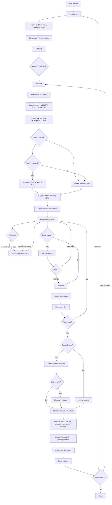

# workflowIA

[](https://claude.ai/claude-code)
[](https://opensource.org/licenses/MIT)

**[Leer en Español](README.es.md)**

A battle-tested development workflow for Claude Code, packaged as the plugin **`wf`**. It gives a
project session tracking, a one-page work queue, 9 specialized agents, the framework rules (`WF-R…`),
deterministic guardrails that run as hooks, parallel sessions support, and full development
traceability. Born from 200+ real development sessions.

The workflow lives **in the plugin**, not in your project: install it once, and every update
reaches every project that uses it. Your project keeps only what is its own — its config, its
`context/` and its `CLAUDE.md`.

## Features

- **Conversational Discovery** (`/wf:discover`) - Frames a new project and derives its stack from the answers; also thinks through new features on a running project
- **Interactive Setup Wizard** (`/wf:setup`) - Configure your project with guided prompts
- **Deterministic Guardrails** - Hooks that deny dangerous git and DB operations *before* they run, instead of trusting that the rule is remembered
- **Anti Context-Rot** - State snapshot before a compaction, critical context re-injected after it
- **ROUTE — the work queue** - One page that answers "what do I work on next?" in 30 seconds
- **Session Tracking** - Document every development session automatically
- **Structured Workflow** - Start and finish features with `/wf:start` and `/wf:finish`
- **9 Specialized Agents** - Context provider, feature architect, test engineer, and more
- **Multi-Category Code Review** - Structured audits with READY/PENDING/CONDITIONAL verdicts
- **System-Wide Audit** (`/wf:audit`) - 8-module code health scan with BACKLOG integration
- **BACKLOG + ROADMAP Tracking** - Bidirectional consistency between sessions and backlog items
- **FIXES Registry** - Centralized bug tracking with quick/complex/batch workflows
- **Evidence Trail** - `verifications/` keeps what was actually tested, separate from what was decided
- **MEMORY System** - Persistent lessons learned across sessions (optional Engram integration)
- **Implementation Plans** - Structured plan workflow with archiving
- **Framework Rules** (`WF-R…`) - Injected as a short index at the start of every session
- **Parallel Sessions** - Shared branch support for 2+ Claude instances working simultaneously
- **Context7 Integration** - Up-to-date library documentation during development
- **Archive Rotation** - Smart cleanup keeping recent sessions, compressing old ones
- **Quality Skills** - Configurable external quality checks for frontend and more
- **Configurable Everything** - Package manager, commands, git conventions, languages, thresholds
- **MCP Integration** - Search, explore and install MCP servers
- **Bilingual Support** - Code and chat language preferences

## Install

### With the plugin (recommended)

From your project folder (new or existing), once:

```bash
claude plugin install wf --marketplace brujoh88/workflowIA -s project
```

That registers the `workflowia` store on your machine and enables `wf` for the project
(`-s project` writes it to `.claude/settings.json`). Then open Claude and run:

```
/wf:setup
```

Its first step copies the files that belong to your project — `CLAUDE.md`,
`.claude/project.config.json`, `context/`, git hooks — **only what is missing, never
overwriting**. Then it asks for the project's commands, branches and limits, enables the git
hooks, declares the store in `.claude/settings.json` so whoever clones the project is offered the
same plugin, and adds those install steps to the project's README.

New project with nothing decided yet? Run `/wf:discover` first: a conversation about the
**business**, not the technology. The stack comes out derived from the answers, with its reasoning
and the alternatives it ruled out.

**Updates**: `claude plugin update wf@workflowia`, then restart Claude.

If your machine already has a `workflowia` store added from another source, the install stops
with "already added from a different source": run `claude plugin marketplace remove workflowia`
and install again.

### Without the plugin

For a project that should not depend on the plugin, `plantilla/` is a ready-to-clone copy with
everything inside (the framework lives in `.claude/wf/`):

```bash
npx degit brujoh88/workflowIA/plantilla my-project
cd my-project && git init && claude        # then: /setup
```

Commands have no prefix there (`/start`, not `/wf:start`). The copy does not get updates — to
follow new versions, move the project to the plugin.

## Day to Day

```
/wf:start             # Takes the item sitting in ROUTE.md → NOW: branch + session + context
... your work ...
/wf:review-code       # Multi-category review; every finding gets routed somewhere
/wf:finish            # Tests + commit + ROUTE/BACKLOG update + archive + rotation
```

New feature idea while the project is running? Run `/wf:discover` again — mode B sizes it, checks
whether it duplicates an existing rule, and places it in the queue.

## Improving the Workflow

The workflow gets better the same way it was born: you notice something while working on a real
project, and fix it here. The difference with the plugin is that projects no longer hold a copy —
they read the plugin — so a fix is made **once**, here, and reaches every project.

1. **Notice it in the project.** Say `/wf:finish` forgets to update the ROADMAP in your project.
   Write it down in this repo's `context/BACKLOG.md` (one line is enough; the evidence goes to
   `context/verifications/`).
2. **Fix it here**, on a branch, with this repo's own workflow (`/wf:start`… `/wf:finish`).
3. **Try it in the real project before publishing.** Open Claude there with your local copy:

   ```bash
   cd ~/my-project
   claude --plugin-dir ~/path/to/workflowIA
   ```

   `--plugin-dir` takes over the installed `wf` for that session only (Claude Code logs
   `Plugin "wf" from --plugin-dir overrides installed version`): nothing is duplicated, and closing
   that session leaves the project on the installed version. Run `/wf:finish` there and check the
   fix does what you wanted.
4. **Publish.** Bump `version` in `.claude-plugin/plugin.json` (installed plugins are cached by
   version), regenerate the no-plugin copy (`scripts/armar-plantilla.sh && git add plantilla/` —
   the pre-commit blocks the commit if you forget), merge, push. Projects pick it up with
   `claude plugin update wf@workflowia`.

## Workflow Diagram



## What Your Project Gets

```
.
├── .claude/
│   ├── project.config.json       # All project settings (single source of truth)
│   ├── settings.json             # Declares the wf plugin for the team
│   ├── MEMORY.md                 # Persistent lessons learned
│   ├── rules/                    # Context-specific rules (api, database, frontend)
│   └── plan/                     # Implementation plans (gitignored)
├── context/
│   ├── ROUTE.md                  # THE work queue: NOW / QUEUE / DONE
│   ├── BACKLOG.md                # Full pending inventory (<300 lines target)
│   ├── ROADMAP.md                # Module progress tracking
│   ├── FIXES.md                  # Bug/fix registry
│   ├── ENVIRONMENT.md            # Access, DB, API traps
│   ├── README.md                 # Session index + rotation rules
│   ├── tmp/                      # Active sessions + pre-compaction snapshot
│   ├── verifications/            # Evidence of manual testing rounds
│   ├── archive/                  # Completed items, archived sessions by quarter
│   ├── auditorias/               # Audit reports
│   └── consolidated/             # Per-feature documentation
├── scripts/hooks/                # git hooks: pre-commit, commit-msg, post-commit, post-merge
└── CLAUDE.md                     # Your project: architecture, commands, business, rules from R27
```

Skills, agents, framework rules and Claude Code hooks are **not** copied: they come with the plugin.

## Three files, three questions

| Question | File |
|----------|------|
| **What do I work on next?** | `context/ROUTE.md` → NOW. One item, one page. |
| **What is still pending overall?** | `context/BACKLOG.md` — the full inventory, unordered. |
| **Where is the product going?** | `context/ROADMAP.md` — modules, progress, dependencies. |

Keeping them separate is the point: ROUTE stays short enough to actually read at the start of
every session, which is what makes it useful.

## Guardrails

Some rules used to depend on remembering them. These run on their own, before the command does.

| Hook | Type | Enforces |
|------|------|----------|
| `claude-guard-main.sh` | PreToolUse | Denies `git commit`/`git push` on the protected branch **before** it executes |
| `claude-guard-db.sh` | PreToolUse | Denies destructive DB operations always; denies migrations outside Docker when configured |
| `claude-verdad-al-escribir.sh` | PostToolUse | Flags a business rule just written in a second place (WF-R25), when the project declares it |
| `commit-msg` | git | Blocks AI attribution + enforces conventional commit format |
| `pre-commit` | git | Protected branch, per-type file size (source code only), TypeScript errors |
| `claude-precompact.sh` | PreCompact | Writes a state snapshot before the conversation is summarized |
| `claude-reglas.sh` | SessionStart | Injects the framework rule index at the start of every session |
| `claude-session-context.sh` | SessionStart | Re-injects branch, session, ROUTE item and key rules after a compaction |

The Claude Code hooks (`claude-*.sh`) come with the plugin and fire whenever it is enabled; the git
hooks are copied to `scripts/hooks/` by `/wf:setup`. A PreToolUse hook exiting with code 2 denies
the tool call and returns its reason as feedback — the command does not run. The pre-commit also
checks the WF-R25 rule, so a copy that slipped past the write-time warning still stops the commit.

## Agents

9 specialized agents, available as `wf:<name>`:

| Agent | Role | Invoked By |
|-------|------|------------|
| **session-tracker** | Session lifecycle, anti-loop commits, rotation | `/wf:start`, `/wf:finish` |
| **context-provider** | Project snapshot, suggested paths, MEMORY | `/wf:start` (auto), direct |
| **feature-architect** | Feature structure, anatomy docs, size limits | `/wf:start` (new features) |
| **code-reviewer** | Standalone multi-category audit with verdicts | `/wf:review-code` |
| **code-explorer** | Codebase navigation and understanding | `/wf:explore-code` |
| **test-engineer** | Tests with coverage BEFORE/AFTER protocol | `/wf:finish` (auto), direct |
| **db-analyst** | Schema design, migrations, queries, indexes | Direct delegation |
| **api-documenter** | API documentation completeness audit | Direct delegation |
| **frontend-integrator** | Components + WCAG AA + dark mode | Direct delegation |

## Available Commands

| Command | Description |
|---------|-------------|
| `/wf:discover` | Frame a new project and derive its stack, or think through a new feature |
| `/wf:setup` | Interactive configuration wizard (config, hooks, MEMORY, quality) |
| `/wf:start [feature]` | Reads ROUTE → NOW + branch + session + Context7 + quality skills |
| `/wf:finish` | Quality check + tests + ROUTE/BACKLOG update + archive + rotation |
| `/wf:review-code` | Multi-category audit + frontend/E2E + quality skill integration |
| `/wf:audit [module]` | System-wide audit: Types, Security, Validation, Size, Coverage, Docs, Arch, Quality |
| `/wf:explore-code` | Navigate and understand codebase |
| `/wf:fix-issue` | Guided debugging workflow (3 hypotheses) |
| `/wf:deploy` | Build, verify, and deploy |
| `/wf:metrics` | Project metrics and health dashboard (read-only) |
| `/wf:mcp` | Search, install, configure MCP servers |

## Configuration

All project configuration is stored in `.claude/project.config.json` (shown after `/wf:setup`,
which turns `allowCommitsOnMain` off — the copied file ships with it on):

```json
{
  "project": { "name": "my-project", "description": "...", "stack": "..." },
  "language": { "code": "en", "chat": "es" },
  "commands": {
    "packageManager": "npm", "test": "npm test", "coverage": "", "lint": "npm run lint",
    "dev": "npm run dev", "build": "npm run build", "syncTypes": ""
  },
  "git": {
    "branchPrefixes": { "feature": "feature/", "fix": "fix/", "hotfix": "hotfix/" },
    "mainBranch": "main", "devBranch": "", "coAuthoredBy": false,
    "allowCommitsOnMain": false
  },
  "conventions": { "files": "kebab-case", "commits": "conventional" },
  "workflow": {
    "maxFileLines": { "default": 400, "services": 500, "components": 300, "hooks": 150 },
    "maxFunctionLines": 50,
    "archiveRotationThreshold": 15, "blockRotationThreshold": 3,
    "backlogMaxLines": 300, "recentSessionsToKeep": 3, "coverageThreshold": 80,
    "staleSessionThreshold": 24, "testMaxWorkers": 2
  },
  "quality": { "externalSkills": [] },
  "docker": { "enabled": false, "dbContainer": "" },
  "memory": { "engram": { "enabled": false, "syncOnCommit": true, "importOnMerge": true } },
  "parallel": {
    "enabled": true, "lockTimeoutSeconds": 60,
    "lockFile": "context/.context.lock",
    "sharedBranch": { "enabled": true, "directory": "context/.parallel", "atomicCommits": true }
  },
  "initialized": true
}
```

## Rules

The framework rules (`WF-R1…WF-R26`) live in one place: [`reglas/REGLAS.md`](reglas/REGLAS.md).
They are not listed here on purpose — a second list would drift. At the start of every session the
plugin injects a short index (one line per rule) with the path to the full text.

Your project's own rules go in its `CLAUDE.md`, numbered from `R27` on.

## Working on This Repository

This repo **is** the plugin and its store (`.claude-plugin/`), and it uses its own workflow:
`context/` holds its sessions, ROUTE and BACKLOG.

```bash
git config core.hooksPath .githooks       # once per clone: enables the plantilla/ lock
claude --plugin-dir .                     # the commands are the plugin's: /wf:start, /wf:finish…
```

`plantilla/` is generated from the plugin and never edited by hand: after touching a skill, agent,
script, rule or template, run `scripts/armar-plantilla.sh && git add plantilla/`. The full layout
and reference is in [`docs/MANUAL.md`](docs/MANUAL.md).

## Requirements

- [Claude Code CLI](https://claude.ai/claude-code) installed
- Git
- `jq` (recommended — the hooks read `.claude/project.config.json` with it; without it the guards
  still block, but with defaults: main branch `main`, no `allowCommitsOnMain`, no Docker settings)
- Node.js, only for the no-plugin clone (`npx degit`)

## License

MIT License - see [LICENSE](LICENSE) for details.
