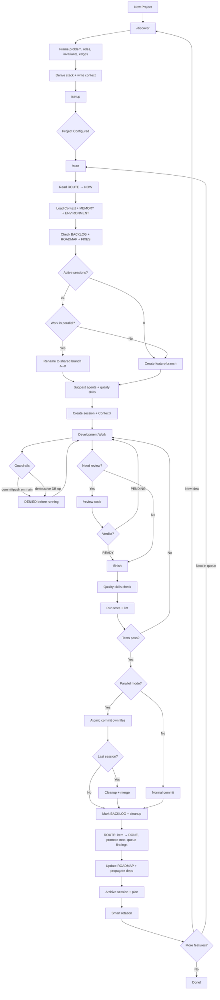

# workflowIA

[](https://claude.ai/claude-code)
[](https://opensource.org/licenses/MIT)

**[Leer en Español](README.es.md)**

A battle-tested project template for AI-assisted development with Claude Code. Provides session tracking, structured workflows, 9 specialized agents, 26 enforced rules, deterministic guardrails that run as hooks, parallel sessions support, and full development traceability out of the box. Born from 200+ real development sessions.

## Features

- **Conversational Discovery** (`/discover`) - Frames a new project and derives its stack from the answers; also thinks through new features on a running project
- **Interactive Setup Wizard** (`/setup`) - Configure your project with guided prompts
- **Deterministic Guardrails** - Hooks that deny dangerous git and DB operations *before* they run, instead of trusting that the rule is remembered
- **Anti Context-Rot** - State snapshot before a compaction, critical context re-injected after it
- **ROUTE — the work queue** - One page that answers "what do I work on next?" in 30 seconds
- **Session Tracking** - Document every development session automatically
- **Structured Workflow** - Start and finish features with `/start` and `/finish`
- **9 Specialized Agents** - Context provider, feature architect, test engineer, and more
- **Multi-Category Code Review** - Structured audits with READY/PENDING/CONDITIONAL verdicts
- **System-Wide Audit** (`/audit`) - 8-module code health scan with BACKLOG integration
- **BACKLOG + ROADMAP Tracking** - Bidirectional consistency between sessions and backlog items
- **FIXES Registry** - Centralized bug tracking with quick/complex/batch workflows
- **Evidence Trail** - `verifications/` keeps what was actually tested, separate from what was decided
- **MEMORY System** - Persistent lessons learned across sessions (optional Engram integration)
- **Implementation Plans** - Structured plan workflow with archiving
- **26 Enforced Rules** - Battle-tested development practices
- **Parallel Sessions** - Shared branch support for 2+ Claude instances working simultaneously
- **Context7 Integration** - Up-to-date library documentation during development
- **Archive Rotation** - Smart cleanup keeping recent sessions, compressing old ones
- **Quality Skills** - Configurable external quality checks for frontend and more
- **Configurable Everything** - Package manager, commands, git conventions, languages, thresholds
- **MCP Integration** - Search, explore and install MCP servers
- **Bilingual Support** - Code and chat language preferences

## Quick Start

### 1. Clone or Use Template

```bash
# Clone the repository
git clone https://github.com/brujoh88/workflowIA.git my-project
cd my-project
```

### 2. Initialize Git (if new project)

```bash
git init
```

### 3. Frame the Project

Open Claude Code and run:

```
/discover
```

A conversation about the **business**, not the technology: what breaks today, who touches it,
what can never happen, which edges change the design, and how small the first useful version is.
The stack comes out **derived from those answers**, with its reasoning and the ruled-out
alternatives stated. It writes the business context, an ADR, the ROADMAP, the BACKLOG and the
first ROUTE item — no code, no installs.

### 4. Run Setup Wizard

```
/setup
```

This will:
- Collect project metadata, stack, and preferences
- Configure commands, git conventions, and quality thresholds
- Install git hooks (pre-commit, commit-msg, post-commit) and register the Claude Code hooks
- Turn off `git.allowCommitsOnMain` so the protected branch is actually protected
- Create MEMORY.md for persistent lessons
- Create folder structure
- Suggest relevant MCP servers (including Context7)

### 5. Start Developing

```
/start                # Takes the item sitting in ROUTE.md → NOW
... your work ...
/review-code          # Multi-category audit with quality skill integration
/finish               # Tests + commit + ROUTE/BACKLOG update + archive + rotation
```

New feature idea while the project is running? Run `/discover` again — mode B sizes it, checks
whether it duplicates an existing rule, and places it in the queue.

---

## Workflow Diagram



---

## Project Structure

```
.
├── .claude/
│   ├── project.config.json       # All project settings
│   ├── settings.json             # Plugin settings + Claude Code hooks registration
│   ├── settings.local.json       # Permissions (gitignored)
│   ├── MANUAL.md                 # User guide for the framework
│   ├── MEMORY.md                 # Persistent lessons learned
│   ├── plan/                     # Implementation plans (gitignored)
│   │   └── completados/          # Archived plans
│   ├── skills/
│   │   ├── discover/             # Product framing + feature discovery [NEW]
│   │   ├── setup/                # Setup wizard
│   │   ├── start/                # Start feature (reads ROUTE → NOW)
│   │   ├── finish/               # Finish feature (updates ROUTE, rotation)
│   │   ├── review-code/          # Code audit (frontend/E2E + quality skills)
│   │   ├── audit/                # System-wide audit (8 modules)
│   │   ├── architecture-ref/     # Architecture patterns (auto-loaded)
│   │   ├── development-protocol-ref/ # Dev protocol reference
│   │   ├── ui-design-system-ref/ # UI design reference
│   │   ├── explore-code/         # Code exploration
│   │   ├── fix-issue/            # Bug fix workflow
│   │   ├── deploy/               # Deployment workflow
│   │   ├── metrics/              # Project metrics dashboard
│   │   └── mcp/                  # MCP server management
│   ├── agents/                   # 9 specialized agents
│   │   ├── session-tracker.md    # Session lifecycle + anti-loop commits
│   │   ├── context-provider.md   # Project snapshot + suggested paths
│   │   ├── feature-architect.md  # Feature structure + anatomy docs
│   │   ├── code-reviewer.md      # Standalone structured audit
│   │   ├── code-explorer.md      # Codebase navigation
│   │   ├── test-engineer.md      # Tests + coverage BEFORE/AFTER
│   │   ├── db-analyst.md         # Schema design + migrations
│   │   ├── api-documenter.md     # API documentation audit
│   │   └── frontend-integrator.md # Components + a11y + dark mode
│   └── rules/                    # Context-specific rules
│       ├── api.md
│       ├── database.md
│       └── frontend.md
├── context/
│   ├── ROUTE.md                  # THE work queue: NOW / QUEUE / DONE [NEW]
│   ├── README.md                 # Session index + rotation rules
│   ├── BACKLOG.md                # Full pending inventory (<300 lines target)
│   ├── ROADMAP.md                # Module progress tracking
│   ├── FIXES.md                  # Bug/fix registry
│   ├── ENVIRONMENT.md            # Access, DB, API traps [NEW]
│   ├── .pending-commits.log      # Auto-registered commits (local, gitignored)
│   ├── tmp/                      # Active sessions + pre-compaction snapshot
│   ├── verifications/            # Evidence of manual testing rounds [NEW]
│   ├── archive/
│   │   ├── COMPLETED.md          # History of completed items
│   │   └── YYYY-QN/
│   │       ├── sessions/         # Archived sessions (quarter from SESSION date)
│   │       └── SUMMARY.md        # Quarterly summary
│   ├── auditorias/               # Audit reports
│   └── consolidated/             # Per-feature documentation
├── scripts/
│   ├── context-lock.sh           # Distributed lock for parallel sessions
│   └── hooks/
│       ├── pre-commit            # Protected branch, file size (R4), TS errors (R16)
│       ├── commit-msg            # No AI attribution + commit format (R3) [NEW]
│       ├── post-commit           # Auto-registers commits (with anti-loop)
│       ├── post-merge            # Imports Engram memories after pull [NEW]
│       ├── claude-guard-main.sh  # Denies commit/push on protected branch [NEW]
│       ├── claude-guard-db.sh    # Denies destructive DB ops [NEW]
│       ├── claude-precompact.sh  # State snapshot before compaction [NEW]
│       └── claude-session-context.sh # Re-injects context after compaction [NEW]
├── CLAUDE.md                     # Project instructions (26 rules + routing)
├── CLAUDE-CHANGELOG.md           # Framework history (kept out of context) [NEW]
└── CLAUDE.local.md               # Local config (gitignored)
```

## Three files, three questions

| Question | File |
|----------|------|
| **What do I work on next?** | `context/ROUTE.md` → NOW. One item, one page. |
| **What is still pending overall?** | `context/BACKLOG.md` — the full inventory, unordered. |
| **Where is the product going?** | `context/ROADMAP.md` — modules, progress, dependencies. |

Keeping them separate is the point: ROUTE stays short enough to actually read at the start of
every session, which is what makes it useful.

## Guardrails

Some rules used to depend on remembering them. These run on their own, before the command does.

| Hook | Type | Enforces |
|------|------|----------|
| `claude-guard-main.sh` | PreToolUse | Denies `git commit`/`git push` on the protected branch **before** it executes |
| `claude-guard-db.sh` | PreToolUse | Denies destructive DB operations always; denies migrations outside Docker when configured |
| `commit-msg` | git | Blocks AI attribution + enforces conventional commit format |
| `pre-commit` | git | Protected branch, per-type file size (source code only), TypeScript errors |
| `claude-precompact.sh` | PreCompact | Writes a state snapshot before the conversation is summarized |
| `claude-session-context.sh` | SessionStart | Re-injects branch, session, ROUTE item and key rules after a compaction |

A PreToolUse hook exiting with code 2 denies the tool call and returns its reason as feedback.
These are not warnings — the command does not run.

> **Note**: this repository ships with `git.allowCommitsOnMain: true`, because its own main branch
> *is* its working branch. `/setup` turns it off for derived projects. If you clone without
> running `/setup`, the branch guard stays asleep.

## Agents

9 specialized agents, each with a focused role:

| Agent | Role | Invoked By |
|-------|------|------------|
| **session-tracker** | Session lifecycle, anti-loop commits, rotation | `/start`, `/finish` |
| **context-provider** | Project snapshot, suggested paths, MEMORY | `/start` (auto), direct |
| **feature-architect** | Feature structure, anatomy docs, size limits | `/start` (new features) |
| **code-reviewer** | Standalone multi-category audit with verdicts | `/review-code` |
| **code-explorer** | Codebase navigation and understanding | `/explore-code` |
| **test-engineer** | Tests with coverage BEFORE/AFTER protocol | `/finish` (auto), direct |
| **db-analyst** | Schema design, migrations, queries, indexes | Direct delegation |
| **api-documenter** | API documentation completeness audit | Direct delegation |
| **frontend-integrator** | Components + WCAG AA + dark mode | Direct delegation |

## Available Commands

| Command | Description |
|---------|-------------|
| `/discover` | Frame a new project and derive its stack, or think through a new feature |
| `/setup` | Interactive configuration wizard (config, hooks, MEMORY, quality) |
| `/start [feature]` | Reads ROUTE → NOW + branch + session + Context7 + quality skills |
| `/finish` | Quality check + tests + ROUTE/BACKLOG update + archive + rotation |
| `/review-code` | Multi-category audit + frontend/E2E + quality skill integration |
| `/audit [module]` | System-wide audit: Types, Security, Validation, Size, Coverage, Docs, Arch, Quality |
| `/explore-code` | Navigate and understand codebase |
| `/fix-issue` | Guided debugging workflow (3 hypotheses) |
| `/deploy` | Build, verify, and deploy |
| `/metrics` | Project metrics and health dashboard (read-only) |
| `/mcp` | Search, install, configure MCP servers |

## Configuration

All configuration is stored in `.claude/project.config.json`:

```json
{
  "project": { "name": "my-project", "description": "...", "stack": "..." },
  "language": { "code": "en", "chat": "es" },
  "commands": {
    "packageManager": "npm", "test": "npm test", "lint": "npm run lint",
    "dev": "npm run dev", "build": "npm run build", "syncTypes": ""
  },
  "git": {
    "branchPrefixes": { "feature": "feature/", "fix": "fix/", "hotfix": "hotfix/" },
    "mainBranch": "main", "devBranch": "", "coAuthoredBy": false,
    "allowCommitsOnMain": false
  },
  "conventions": { "files": "kebab-case", "commits": "conventional" },
  "workflow": {
    "maxFileLines": { "default": 400, "services": 500, "components": 300, "hooks": 150 },
    "maxFunctionLines": 50,
    "archiveRotationThreshold": 15, "blockRotationThreshold": 3,
    "backlogMaxLines": 300, "recentSessionsToKeep": 3, "coverageThreshold": 80,
    "staleSessionThreshold": 24, "testMaxWorkers": 2
  },
  "quality": { "externalSkills": [] },
  "docker": { "enabled": false, "dbContainer": "" },
  "memory": { "engram": { "enabled": false, "syncOnCommit": true, "importOnMerge": true } },
  "parallel": {
    "enabled": true, "lockTimeoutSeconds": 60,
    "lockFile": "context/.context.lock",
    "sharedBranch": { "enabled": true, "directory": "context/.parallel", "atomicCommits": true }
  },
  "initialized": true
}
```

## Enforced Rules (26)

| # | Rule | Description |
|---|------|-------------|
| R1 | Language | Respond/code in configured language |
| R2 | Git Flow | main protected, dev branch support |
| R3 | Commits | Co-Authored-By configurable |
| R4 | File Size | Per-type max lines — source code only |
| R5 | Testing | Coverage BEFORE/AFTER, threshold target |
| R6 | Verify First | Glob+Grep before creating |
| R7 | BACKLOG Compaction | Stay under max lines |
| R8 | Delegation | Mandatory agent/skill delegation |
| R9 | Plans | Structured plan workflow |
| R10 | Fix Workflows | Quick/complex/batch patterns |
| R11 | No Premature Action | Read, understand, ask |
| R12 | Debugging Protocol | 3 hypotheses before fixing |
| R13 | Session Discipline | Start creates, finish closes |
| R14 | Zero Inference | Concrete sources only |
| R15 | Quality Skills | Frontend quality checks |
| R16 | LSP Diagnostics | Type errors are blockers |
| R17 | Sync MANUAL | Keep docs up to date |
| R18 | Docker Environment | DB commands inside container |
| R19 | CPU Limiting | Test workers capped |
| R20 | Migrations Protocol | Generate diff, review, deploy |
| R21 | Parallel Sessions | Shared branch, atomic commits, context lock |
| R22 | Quarter Detection | Archive by the SESSION's date, never today's |
| R23 | Deterministic Guardrails | Hooks enforce rules before the command runs |
| R24 | `/fast` Mode | User-only toggle; Claude suggests, never activates |
| R25 | One Business Rule, One Home | "Is this allowed?" lives in one pure function everyone imports |
| R26 | Engram | Optional persistent recall for decisions and root causes |

## Requirements

- [Claude Code CLI](https://claude.ai/claude-code) installed
- Git
- `jq` (recommended — hooks read the config with it; without it they fail open)

## Contributing

Contributions are welcome! Please feel free to submit a Pull Request.

## License

MIT License - see [LICENSE](LICENSE) for details.
